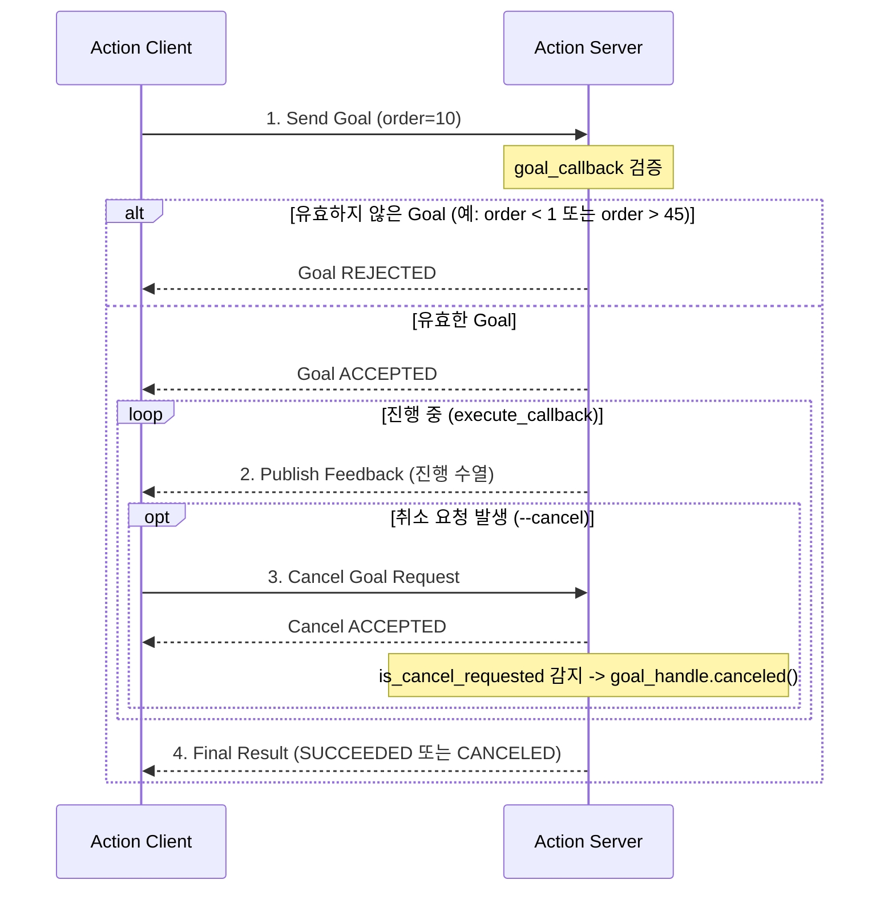

# 모듈 03: ROS 2 Services 및 Actions 심층 실습

본 문서는 ROS 2의 양방향 요청·응답 통신인 **서비스(Services)**와 장기 실행 및 선점(Preemption)이 가능한 **액션(Actions)**의 핵심 개념, 비동기 클라이언트 설계, 그리고 취소(Cancellation) 처리 메커니즘을 단계별로 체득할 수 있도록 구성된 교육 실습 가이드입니다.

---

## 1. 통신 패러다임 비교: Topic vs Service vs Action

로봇 소프트웨어 아키텍처를 설계할 때 통신 목적에 따라 적절한 통신 방식을 선택해야 합니다:

| 통신 방식 | 상호작용 형태 | 데이터 흐름 | 주요 특징 | 실무 적용 사례 |
| :--- | :--- | :--- | :--- | :--- |
| **Topic** | 단방향 발행-구독 (Pub/Sub) | 1:N 스트리밍 | 비동기 연속 데이터, 수신 확인 없음 (Best Effort/Reliable) | 센서 계측치(IMU, LiDAR), 카메라 영상, 속도 명령(`/cmd_vel`) |
| **Service** | 양방향 요청-응답 (RPC) | 1:1 동기/비동기 | 짧은 계산이나 즉각적인 설정 변경, 응답 대기 블로킹 | 모터 전원 켜기, 맵 저장 요청, 좌표 변환 연산 |
| **Action** | 목표-피드백-결과-취소 | 1:1 장기 작업 | 작업 진행률 피드백 전송, 실행 중 취소(Cancel) 및 목표 선점 | 내비게이션 자율주행 목표 이동, 로봇 암 궤적 추종, SLAM 맵 빌드 |

---

## 2. 핵심 개념 및 아키텍처

### 2.1 Service 통신 구조
- **Client $\to$ Server:** 클라이언트가 `Request` 메시지를 보내면, 서버는 요청을 처리한 후 `Response` 메시지를 회신합니다.
- **`call_async()`와 실행기(Executor):**
  클라이언트가 동기식(`call()`)으로 호출하면 현재 스레드가 블로킹되어 다른 콜백이 처리되지 못하고 데드락(Deadlock)에 빠질 수 있습니다.  
  따라서 ROS 2에서는 **비동기 호출인 `call_async()`**를 수행하고 `Future` 객체를 반환받은 뒤, `rclpy.spin_until_future_complete(node, future)`를 통해 실행기 이벤트 루프를 안전하게 회전시킵니다.

### 2.2 Action 생명주기 및 취소(Cancellation) 메커니즘
Action은 내부적으로 3개의 서비스(Goal, Cancel, Result)와 2개의 토픽(Feedback, Status)으로 구성된 고도화된 복합 통신입니다.



#### 동시성(Concurrency)과 `MultiThreadedExecutor`의 필수성
Action 서버가 작업을 수행(`execute_callback`)하는 동안 클라이언트가 보낸 취소 요청(`cancel_callback`)을 가로채려면:
- 기본 `SingleThreadedExecutor`를 사용할 경우, `execute_callback`이 스레드를 점유하여 취소 요청 서비스가 큐에 갇히게 됩니다.
- 따라서 **`ReentrantCallbackGroup`**과 **`MultiThreadedExecutor`**를 적용하여, 작업 스레드와 취소 요청 처리 스레드가 동시에 병렬 동작할 수 있도록 설계해야 합니다.

---

## 3. 패키지 파일 구성

신규 패키지 `src/service_action_py/`의 파일별 역할입니다:

| 파일 경로 | 역할 및 핵심 기능 |
| :--- | :--- |
| `service_action_py/add_two_ints_server.py` | `AddTwoInts` 서비스 서버: 두 정수를 받아 합을 계산하고 로깅 |
| `service_action_py/add_two_ints_client.py` | 비동기 서비스 클라이언트: CLI 인자 파싱, 서비스 발견 대기, `call_async()` 호출 |
| `service_action_py/fibonacci_action_server.py` | Action 서버: `order` 범위 검증(오버플로 방지), 주기적 피드백, 협력적 취소 처리 |
| `service_action_py/fibonacci_action_client.py` | Action 클라이언트: 비동기 Goal 전송, 진행 피드백 수신, `--cancel` 플래그를 통한 취소 실습 |

---

## 4. 환경 설정 및 빌드 절차

> [!IMPORTANT]
> **새 터미널 환경 설정 안내:**
> 새 터미널 창을 열 때마다 반드시 아래 두 단계의 환경 소싱을 수행해야 합니다:
> ```bash
> source /opt/ros/humble/setup.bash
> cd 02_ros2_core_curriculum
> source install/setup.bash
> ```

### 워크스페이스 빌드
```bash
source /opt/ros/humble/setup.bash
cd 02_ros2_core_curriculum

colcon build --packages-select service_action_py
source install/setup.bash
```

---

## 5. 단계별 실행 실습 (Part A: Service)

### 5.1 Service 서버 실행
```bash
# 터미널 1
source /opt/ros/humble/setup.bash
cd 02_ros2_core_curriculum
source install/setup.bash

ros2 run service_action_py add_two_ints_server
```
**기대 출력:**
```text
[INFO] [add_two_ints_server]: AddTwoIntsServer ready. Service "add_two_ints" is advertising.
```

### 5.2 Service 클라이언트 실행 (비동기 호출)
```bash
# 터미널 2 (새 창)
source /opt/ros/humble/setup.bash
cd 02_ros2_core_curriculum
source install/setup.bash

ros2 run service_action_py add_two_ints_client -- 10 20
```

**터미널 2 출력:**
```text
[INFO] [add_two_ints_client]: Sending async request: 10 + 20
[INFO] [add_two_ints_client]: Received response: 10 + 20 = 30
RESULT: 30
```

**터미널 1 서버 출력:**
```text
[INFO] [add_two_ints_server]: Incoming request: a=10, b=20
[INFO] [add_two_ints_server]: Sending response: sum=30
```

### 5.3 ROS 2 CLI를 이용한 Service 직접 호출 및 디버깅
서버가 켜진 상태에서 터미널 2에서 표준 CLI 명령을 통해 서비스를 직접 점검할 수 있습니다:

```bash
# 서비스 목록 확인
ros2 service list | grep add_two_ints
# -> /add_two_ints

# 서비스 인터페이스 타입 확인
ros2 service type /add_two_ints
# -> example_interfaces/srv/AddTwoInts

# CLI에서 직접 요청 전송
ros2 service call /add_two_ints example_interfaces/srv/AddTwoInts "{a: 100, b: 250}"
# -> response: example_interfaces.srv.AddTwoInts_Response(sum=350)
```

### 5.4 서버 미실행 시 클라이언트 에러 처리 관찰
터미널 1의 서버를 종료(Ctrl+C)한 후 클라이언트를 실행하면:
```bash
ros2 run service_action_py add_two_ints_client -- 5 7
```
**출력:**
```text
[WARN] [add_two_ints_client]: Service "add_two_ints" not available yet, waiting (1s)...
[WARN] [add_two_ints_client]: Service "add_two_ints" not available yet, waiting (2s)...
...
[ERROR] [add_two_ints_client]: Service discovery timed out after 5 seconds. Ensure "ros2 run service_action_py add_two_ints_server" is running.
```
- 초보자가 서버 부재 상황을 명확히 인지할 수 있는 방어적 예외 처리가 동작합니다.

---

## 6. 단계별 실행 실습 (Part B: Action)

### 6.1 Action 서버 실행
```bash
# 터미널 1
source /opt/ros/humble/setup.bash
cd 02_ros2_core_curriculum
source install/setup.bash

ros2 run service_action_py fibonacci_action_server
```
**기대 출력:**
```text
[INFO] [fibonacci_action_server]: FibonacciActionServer ready. Advertising action "fibonacci" (Valid orders: 1..45).
```

### 6.2 Action 정상 완료 실습 (Feedback 및 Result)
```bash
# 터미널 2 (새 창)
source /opt/ros/humble/setup.bash
cd 02_ros2_core_curriculum
source install/setup.bash

ros2 run service_action_py fibonacci_action_client -- 10
```

**터미널 2 클라이언트 진행 로그:**
```text
[INFO] [fibonacci_action_client]: Sending goal request: order=10 (request_cancel=False)
[INFO] [fibonacci_action_client]: Goal ACCEPTED by server. Processing execution (order=10)...
[INFO] [fibonacci_action_client]: Feedback received (#1): [0, 1, 1]
[INFO] [fibonacci_action_client]: Feedback received (#2): [0, 1, 1, 2]
[INFO] [fibonacci_action_client]: Feedback received (#3): [0, 1, 1, 2, 3]
...
[INFO] [fibonacci_action_client]: Feedback received (#9): [0, 1, 1, 2, 3, 5, 8, 13, 21, 34, 55]
[INFO] [fibonacci_action_client]: SUCCESS: Action succeeded! Result sequence: [0, 1, 1, 2, 3, 5, 8, 13, 21, 34, 55]
STATUS: 4
SEQUENCE: [0, 1, 1, 2, 3, 5, 8, 13, 21, 34, 55]
```
*(매 스텝마다 피드백이 실시간으로 도착하며 최종 계산 결과가 반환됩니다.)*

> [!NOTE]
> **Fibonacci `order` 매개변수의 의미:**  
> `order`는 반환되는 배열의 총 원소 개수(길이)가 아니라, **마지막으로 계산할 피보나치 항의 0 기반 인덱스 $n$($F_n$)**을 의미합니다.  
> 수열은 $F_0=0$부터 시작하여 $F_n$까지 순차적으로 생성되므로, 정상적인 현재 구현에서는 **`order + 1`개의 원소**가 반환됩니다.  
> (예: `order=5` 요청 시 $F_0 \sim F_5$가 계산되어 `[0, 1, 1, 2, 3, 5]` 총 6개 원소 반환)

---

### 6.3 의도적인 비정상 Goal 거부(Reject) 실험
Action 서버는 수학적·물리적 한계를 벗어나는 요청을 사전에 거부해야 합니다:
- `order < 1`: 0 또는 음수 수열 요청 거부.
- `order > 45`: `int32` 부호형 정수 최대치($2^{31}-1 = 2,147,483,647$)를 초과하여 오버플로가 발생하는 $F_{47}$ 방지를 위해 45 초과 거부.

```bash
# 음수 Goal 전송
ros2 run service_action_py fibonacci_action_client -- -5
```
**터미널 2 클라이언트 출력:**
```text
[WARN] [fibonacci_action_client]: Goal REJECTED by server: order=-5
STATUS: REJECTED (no action result status)
SEQUENCE: []
```
**터미널 1 서버 출력:**
```text
[WARN] [fibonacci_action_server]: REJECTING Goal: order=-5 is non-positive. Order must be >= 1.
```
- **개념 확인:** Goal 거부(`REJECT`)는 목표가 Action 수명주기에 진입하기 전 사전에 차단되는 것이므로, 실행 중단 상태인 `STATUS_ABORTED` (6)가 아닌 상태 미할당(`REJECTED`)으로 정확히 처리됩니다.

---

### 6.4 실행 중 선점 취소(Cancellation) 실습
작업 도중 클라이언트가 `--cancel` 플래그를 전달하면, 피드백을 수신한 직후 취소 요청을 발송합니다.

```bash
# 취소 플래그를 포함하여 실행
ros2 run service_action_py fibonacci_action_client -- 10 --cancel
```

**터미널 2 클라이언트 출력:**
```text
[INFO] [fibonacci_action_client]: Sending goal request: order=10 (request_cancel=True)
[INFO] [fibonacci_action_client]: Goal ACCEPTED by server. Processing execution (order=10)...
[INFO] [fibonacci_action_client]: Feedback received (#1): [0, 1, 1]
[INFO] [fibonacci_action_client]: Feedback received (#2): [0, 1, 1, 2]
[WARN] [fibonacci_action_client]: Sending cancellation request to action server now...
[INFO] [fibonacci_action_client]: Cancel response received: return_code=0
[WARN] [fibonacci_action_client]: CANCELED: Action successfully canceled! Partial sequence: [0, 1, 1, 2]
STATUS: 5
SEQUENCE: [0, 1, 1, 2]
```

**터미널 1 서버 출력:**
```text
[INFO] [fibonacci_action_server]: Received client cancellation request. Accepting cancellation.
[WARN] [fibonacci_action_server]: Goal canceled by client during step 3/10. Partial sequence: [0, 1, 1, 2]
```
- **판정:** 서버와 클라이언트가 `CANCELED (STATUS=5)` 상태 전이를 정확히 수행하고 부분 수열을 반환함을 확인했습니다.

---

## 7. ROS 2 CLI를 이용한 Action 디버깅 가이드

```bash
# 액션 목록 확인
ros2 action list
# -> /fibonacci

# 액션 정보 확인 (클라이언트 및 서버 개수)
ros2 action info /fibonacci

# CLI를 통한 직접 Goal 전송 및 피드백 모니터링
ros2 action send_goal --feedback /fibonacci example_interfaces/action/Fibonacci "{order: 5}"
```

---

## 8. 실환경 검증 결과 요약 (`[VERIFIED]`)

Ubuntu 22.04 LTS / ROS 2 Humble 환경에서 실측 검증된 사실입니다:
- `colcon build --packages-select service_action_py` 빌드 성공 (`Exit Code: 0`).
- `add_two_ints` 서버 및 비동기 클라이언트 연동 성공 (`10 + 20 = 30`).
- `fibonacci` 액션 서버 정상 수열 계산 및 피드백 스트리밍 성공 (`order=10`).
- 음수 및 45 초과 Goal에 대한 사전 거부(`GoalResponse.REJECT`) 동작 확인.
- `MultiThreadedExecutor` 기반 협력적 취소(`goal_handle.is_cancel_requested`) 및 `STATUS_CANCELED (5)` 정상 반영 확인.
- SIGINT 종료 시 잔여 프로세스 0개 확인.

---

## 9. 공식 출처 및 저작권 고지

- **공식 표준 문서:**
  - [ROS 2 Humble Documentation: Writing a simple service and client (Python)](https://docs.ros.org/en/humble/Tutorials/Beginner-Client-Libraries/Writing-A-Simple-Py-Service-And-Client.html)
  - [ROS 2 Humble Documentation: Writing an action server and client (Python)](https://docs.ros.org/en/humble/Tutorials/Intermediate/Writing-an-Action-Server-Client/Py.html)
  - [ROS 2 Humble Documentation: Understanding Actions](https://docs.ros.org/en/humble/Tutorials/Beginner-CLI-Tools/Understanding-ROS2-Actions/Understanding-ROS2-Actions.html)
- **라이선스:** Apache License, Version 2.0
