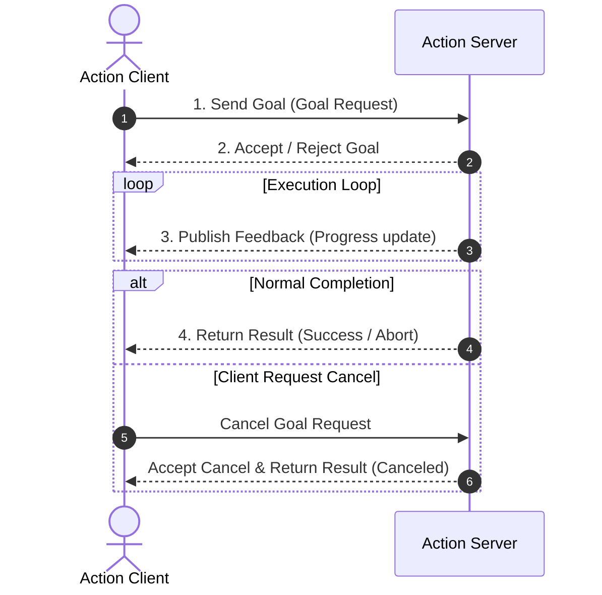

# 📡 ROS 2 핵심 개념과 통신 인터페이스 (Core & Interfaces)

> 📖 **교재 참고**: `[WeGo] Limo_ROS2_교재.pdf` (제4장 ROS 2 Basic Programming, pp. 91~167 / 제5장 LIMO 소개 및 센서, pp. 190~218)<br>
> 💻 **로컬 검증 소스**: `~/learning/ros2_ws/src/wego_msgs/`, `~/learning/ros2_ws/src/wego_service_demo/`<br>
> 🏷️ **실습 상태**: `[개념 학습 완료]`, `[로컬 소스 검증 완료]`, `[시뮬레이터 실습 완료]`

---

## 1. 개요 및 학습 목표

ROS 2(Robot Operating System 2)의 통신 시스템은 노드(Node) 간의 데이터 교환을 담당하는 분산 미들웨어(DDS, Data Distribution Service) 기반의 구조를 가집니다. 본 문서에서는 로봇 제어 시스템을 구성하는 3대 통신 패턴(Topic, Service, Action)의 동작 원리와 상태 전이를 비교하고, 표준 및 사용자 정의(Custom) 인터페이스의 정의 방식, 그리고 동적 파라미터(Parameter)와 런치(Launch) 시스템의 연동 메커니즘을 정리합니다.

---

## 2. ROS 2의 3대 통신 메커니즘 비교 분석

> 📖 **교재 참고**: 제4장 4.4절~4.7절 (pp. 104~151)

ROS 2는 제어 목적과 데이터 특성에 따라 상호 보완적인 3가지 통신 방식을 제공합니다.

| 구분 | 토픽 (Topic) | 서비스 (Service) | 액션 (Action) |
| :--- | :--- | :--- | :--- |
| **통신 패턴** | 단방향 비동기 스트리밍 (Publish-Subscribe) | 양방향 동기/비동기 요청-응답 (Request-Response) | 양방향 비동기 목표 추종 (Goal-Feedback-Result) |
| **관계** | N : M (다대다 통신) | 1 : 1 (클라이언트 : 서버) | 1 : 1 (액션 클라이언트 : 액션 서버) |
| **실행 특성** | 연속적 데이터 전송, 논블로킹 | 즉각적이고 짧은 작업 처리, 응답 완료까지 대기 | 장기 실행(Long-running) 작업, 중간 취소 가능 |
| **주요 용도** | 센서 데이터 스트리밍(LiDAR, IMU, Camera), 주기적 속도 명령(`/cmd_vel`) | 간단한 상태 조회, 모드 전환, 파라미터 설정, 계산 요청 | 특정 좌표 이동, 궤적 추종, 장애물 회피, 도킹 등 시간 소요 태스크 |
| **피드백** | 없음 | 결과 응답 1회 | 지속적인 중간 진행률 피드백 전송 |

### 2.1. 액션(Action)의 내부 구조와 상태 머신
액션 통신은 내부적으로 다음과 같은 3개의 하위 인터페이스(Topic 및 Service) 조합으로 동작합니다:
1. **Goal Service**: 클라이언트가 목표를 전송하고 서버가 이를 수락(Accept) 또는 거절(Reject)하는 요청-응답 서비스.
2. **Feedback Topic**: 작업 수행 중 진행 상황(경과 시간, 잔여 거리 등)을 주기적으로 발행하는 토픽.
3. **Result Service**: 작업이 완료(Succeeded), 중단(Aborted), 또는 취소(Canceled)되었을 때 최종 결과를 반환하는 서비스.
4. **Cancel Service**: 클라이언트가 작업 도중 능동적으로 중단을 요청할 수 있는 취소 서비스.



---

## 3. 커스텀 인터페이스 정의 및 빌드 메커니즘

> 📖 **교재 참고**: 제4장 4.5절~4.7절 (pp. 115~151)<br>
> 💻 **로컬 검증 소스**: `~/learning/ros2_ws/src/wego_msgs/` (`[로컬 소스 검증 완료]`)

ROS 2에서는 표준 타입 외에 시스템 요구사항에 맞는 메시지(`msg`), 서비스(`srv`), 액션(`action`) 인터페이스를 직접 정의할 수 있습니다.

### 3.1. `wego_msgs` 패키지 인터페이스 명세
로컬 작업 공간에 구축된 `wego_msgs`의 실제 인터페이스 구성은 다음과 같습니다:

1. **`Counter.msg` (`msg/Counter.msg`)**:
   ```text
   int32 count
   string name
   ```
2. **`AddNumbers.srv` (`srv/AddNumbers.srv`)**:
   ```text
   int32 a
   int32 b
   ---
   int32 sum
   ```
   *(`---` 구분자를 기준으로 상단은 요청 필드, 하단은 응답 필드)*
3. **`Timer.action` (`action/Timer.action`)**:
   ```text
   builtin_interfaces/Duration time_to_wait
   ---
   builtin_interfaces/Duration time_elapsed
   int32 updates_sent
   ---
   builtin_interfaces/Duration time_elapsed
   builtin_interfaces/Duration time_remaining
   ```
   *(`---` 구분자를 기준으로 첫 번째는 Goal, 두 번째는 Result, 세 번째는 Feedback)*

### 3.2. `CMakeLists.txt` 및 인터페이스 빌드 매크로
커스텀 인터페이스는 C++/Python 바인딩 코드를 자동 생성하기 위해 `rosidl_default_generators`를 사용하여 선언해야 합니다.

```cmake
cmake_minimum_required(VERSION 3.8)
project(wego_msgs)

find_package(ament_cmake REQUIRED)
find_package(builtin_interfaces REQUIRED)
find_package(rosidl_default_generators REQUIRED)

rosidl_generate_interfaces(${PROJECT_NAME}
  "msg/Counter.msg"
  "srv/AddNumbers.srv"
  "action/Timer.action"
  DEPENDENCIES builtin_interfaces
)

ament_export_dependencies(rosidl_default_runtime)
ament_package()
```

- `rosidl_generate_interfaces`: 선언된 파일들로부터 각 언어별 메시지 헤더와 파이썬 모듈을 생성하는 핵심 매크로.
- `package.xml`의 의존성:
  - `<build_depend>rosidl_default_generators</build_depend>`
  - `<exec_depend>rosidl_default_runtime</exec_depend>`
  - `<member_of_group>rosidl_interface_packages</member_of_group>`

---

## 4. 파라미터(Parameter)와 Launch 시스템 연동

> 📖 **교재 참고**: 제4장 4.8절 (pp. 152~167)<br>
> 💻 **로컬 검증 소스**: `~/learning/ros2_ws/turtlesim_params.yaml`, `wego_service_demo/launch/turtlesim.launch.py`

### 4.1. 파라미터의 동적 관리
노드는 하드코딩된 값 대신 외부에서 조정 가능한 파라미터를 등록하여 유연하게 동작합니다:
- 파라미터 선언: `self.declare_parameter('parameter_name', default_value)`
- 파라미터 조회: `self.get_parameter('parameter_name').value`

### 4.2. YAML 파라미터 파일 (`turtlesim_params.yaml`)
```yaml
/turtlesim:
  ros__parameters:
    background_b: 0
    background_g: 0
    background_r: 255
    qos_overrides:
      /parameter_events:
        publisher:
          depth: 1000
          durability: volatile
          history: keep_last
          reliability: reliable
    use_sim_time: false
```

### 4.3. Python Launch 파일 (`turtlesim.launch.py`)
Launch 시스템은 여러 노드를 동시에 실행하고 파라미터를 일괄 주입하는 표준 진입점입니다:

```python
from launch import LaunchDescription
from launch_ros.actions import Node

def generate_launch_description():
    return LaunchDescription([
        Node(
            package='turtlesim',
            executable='turtlesim_node',
            name='turtlesim',
            parameters=[{
                'background_r': 0,
                'background_g': 255,
                'background_b': 0,
            }],
            output='screen'
        ),
        Node(
            package='turtlesim',
            executable='turtle_teleop_key',
            name='turtle_teleop_key',
            output='screen'
        )
    ])
```

---

## 5. 표준 센서 인터페이스 규격

> 📖 **교재 참고**: 제5장 5.4.2절~5.4.7절 (pp. 190~218)

모바일 로봇 플랫폼(LIMO 등)에서 널리 활용되는 주요 표준 메시지 타입의 구조와 핵심 필드는 다음과 같습니다.

### 5.1. `std_msgs/msg/Header`의 공통 역할
모든 표준 센서 메시지는 `header` 필드를 포함하며, 이는 데이터의 시공간적 일관성을 보장합니다:
- `header.stamp`: 센서가 데이터를 수집한 정확한 시각 (`sec`, `nanosec`). 시계열 동기화에 필수.
- `header.frame_id`: 데이터가 측정된 기준 좌표 프레임 (예: `laser_link`, `imu_link`, `base_link`, `odom`). TF2 좌표 변환의 기준점.

### 5.2. `sensor_msgs/msg/Imu`
관성 측정 장치(IMU)로부터 3축 가속도와 3축 각속도, 방향(자세)을 수신합니다:
- `orientation`: 쿼터니언 형태의 자세 (`x`, `y`, `z`, `w`)
- `orientation_covariance`: 자세 추정 공분산 ($3 \times 3$)
- `angular_velocity`: 각속도 Vector3 (`rad/s`)
- `angular_velocity_covariance`: 각속도 공분산
- `linear_acceleration`: 선가속도 Vector3 (`m/s^2`)
- `linear_acceleration_covariance`: 가속도 공분산

### 5.3. `sensor_msgs/msg/LaserScan`
2D LiDAR 센서의 단면 거리 측정 배열 데이터입니다:
- `angle_min`, `angle_max`: 스캔 시작 각도 및 종료 각도 (`rad`)
- `angle_increment`: 빔 간 각도 간격 (`rad`)
- `time_increment`, `scan_time`: 측정 시간 간격
- `range_min`, `range_max`: 유효 감지 최소/최대 거리 (`m`)
- `ranges`: 각도별 측정 거리 리스트 (`float32[]`)
- `intensities`: 반사 강도 리스트 (`float32[]`)

### 5.4. `sensor_msgs/msg/Image` vs `CompressedImage`
- **`sensor_msgs/msg/Image`**: 비압축 원본 래스터 이미지 (`height`, `width`, `encoding` 예: `bgr8`, `rgb8`, `step`, `data` 바이트 배열). 로컬 메모리 통신 시 연산 부하가 적으나 대역폭 소모가 큼.
- **`sensor_msgs/msg/CompressedImage`**: 압축 이미지 (`format` 예: `jpeg`, `png`, `data` 압축 바이트 배열). 네트워크 및 무선 전송 시 대역폭을 크게 절약할 수 있으나 압축/복원 연산 필요.
- **`cv_bridge`의 역할**: ROS Image 메시지와 OpenCV `cv::Mat` (Python의 NumPy 배열) 간의 상호 변환을 담당하는 표준 어댑터.

### 5.5. `nav_msgs/msg/Odometry`
로봇의 추정된 현재 위치 및 속도(주행기록계) 정보입니다:
- `header.frame_id`: 고정 참조 좌표계 (일반적으로 `odom`)
- `child_frame_id`: 이동 로봇 중심 좌표계 (일반적으로 `base_link` 또는 `base_footprint`)
- `pose.pose`: 위치 Point (`x`, `y`, `z`) 및 방향 Quaternion (`x`, `y`, `z`, `w`)
- `pose.covariance`: 위치/자세 추정 불확실도 행렬 ($6 \times 6$)
- `twist.twist`: 선속도 Vector3 및 각속도 Vector3
- `twist.covariance`: 속도 추정 불확실도 행렬 ($6 \times 6$)

---

## 6. 학습 검증 및 미확인 사항

1. **검증 완료 항목**:
   - `wego_msgs`의 Custom 인터페이스 3종(`Counter.msg`, `AddNumbers.srv`, `Timer.action`) 소스 코드 확인 및 정의 검증.
   - `wego_service_demo`의 Action Server/Client, Service Server/Client, Launch 파일, Parameter 연동 확인.
   - 표준 센서 인터페이스 구조 및 Header 프레임 해석.
2. **미검증 / 한계 사항**:
   - 본 문서의 내용은 로컬 소스 코드 분석 및 Turtlesim 시뮬레이션에 기반하며, 실제 실물 LIMO 하드웨어 센서 드라이버와의 실시간 통신은 포함되지 않았습니다.
