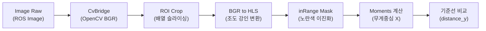

# 🚗 LIMO 응용 프로그래밍 (LIMO Application Programming)

> 📖 **교재 참고**: `[WeGo] Limo_ROS2_교재.pdf` (제6장 LIMO Basic Programming, pp. 221~259)<br>
> 💻 **코드 출처**: 교재 수록 예제 코드 (`limo_ros2_application` 패키지)<br>
> 🏷️ **실습 상태**: `[개념 학습 완료]`, `[교재 코드 분석 완료]`, `[로컬 소스 미구현 (교재 분석 완료)]`, `[미검증 (실제 하드웨어 미주행)]`

---

## 1. 개요 및 학습 목표

AgileX LIMO 플랫폼에 장착된 복합 센서(IMU, LiDAR, RGB 카메라)를 활용하여 모바일 로봇의 자율주행 기본 응용 노드를 구축하고, 이를 하나의 파이프라인으로 통합하는 제어 시스템을 분석합니다.

본 문서는 교재 제6장의 핵심 예제인 **절대 각도 회전 제어(`rotate_absolute.py`)**, **LiDAR 기반 비상 정지 플래그(`limo_e_stop.py`)**, **비전 기반 차선 검출(`detect_line.py`)**, 그리고 **통합 자율주행 제어기(`limo_control.py`)**의 입력·처리·출력 로직 및 알고리즘 한계점을 분석합니다.

> [!WARNING]
> **실제 하드웨어 검증 상태 안내**:<br>
> 본 문서의 모든 알고리즘과 제어 로직은 교재의 소스 코드와 이론을 정밀 분석한 결과이며, **실물 LIMO 로봇 하드웨어 상에서의 주행 테스트는 수행되지 않았습니다 (`[미검증 (실제 하드웨어 미주행)]`)**. 로컬 작업 공간(`ros2_ws/src/`)에도 해당 패키지는 아직 배치되지 않은 분석 단계입니다.

---

## 2. IMU 기반 절대 각도 회전 제어 (`rotate_absolute.py`)

> 📖 **교재 참고**: 제6장 6.2절 (pp. 229~234)<br>
> 🏷️ **상태**: `[개념 학습 완료]`, `[교재 코드 분석 완료]`, `[미검증 (실제 하드웨어)]`

### 2.1. 동작 원리 및 데이터 흐름
로봇의 현재 헤딩(Yaw) 각도를 IMU 센서로부터 측정하고, 사용자가 지정한 목표 각도(`goal_yaw_`)와의 차이에 비례하여 각속도를 명령함으로써 제자리 회전을 수행합니다.

- **입력 (Subscriber)**: `/imu` (`sensor_msgs/msg/Imu`)
- **출력 (Publisher)**: `/cmd_vel` (`geometry_msgs/msg/Twist`)
- **제어 루프 (Timer)**: 0.1초(10Hz) 주기 콜백

### 2.2. 쿼터니언 $\rightarrow$ 오일러(Yaw) 변환 및 각도 정규화
IMU의 3D 자세는 쿼터니언($q_x, q_y, q_z, q_w$)으로 전달되므로, 수평 회전각(Yaw, $\psi$)을 추출하기 위해 다음의 오일러 변환을 수행합니다:

$$\psi = \text{atan2}(2(q_w q_z + q_x q_y), 1 - 2(q_y^2 + q_z^2))$$

추출된 각도는 주기성($-\pi \sim \pi$)을 가지므로, 목표 각도와의 오차 계산 시 최단 회전 방향을 보장하기 위해 각도 정규화(`normalize_angle`)를 수행해야 불필요하게 한 바퀴를 돌아 회전하는 현상을 방지할 수 있습니다.

### 2.3. 각도 오차 기반 회전 제어 로직 (교재 코드 기준)
교재 코드(`rotate_absolute.py`, pp. 230~231)의 실제 제어 루틴은 연속적인 비례(P) 게인 곱셈이 아니라, 각도 오차의 부호에 따른 **고정 각속도 방향 제어(Bang-Bang 방식)**로 구현되어 있습니다:

- **오차 계산 및 정규화**:
  ```python
  gap = self.goal_yaw_ - self.current_yaw_
  gap = normalize_angle(gap)
  ```
- **목표 도달 판정 (허용 오차 $0.05\text{ rad}$)**:
  ```python
  if abs(gap) < 0.05:
      self.get_logger().info('Goal Reached: ')
      rclpy.shutdown()
      self.destroy_node()
  ```
- **방향별 고정 각속도 명령**:
  ```python
  if gap > 0:
      cmd.angular.z = 0.3
  else:
      cmd.angular.z = -0.3
  self.publisher_.publish(cmd)
  ```
> 💡 **보충 설명**: 연속적인 비례 게인($K_p \cdot \text{gap}$) 제어는 본 예제가 아닌 이후 6.5절의 `limo_control.py` 및 7.4절의 `move_to_pose.py`에서 적용됩니다.

---

## 3. LiDAR 기반 전방 장애물 판정 및 비상 정지 (`limo_e_stop.py`)

> 📖 **교재 참고**: 제6장 6.3절 (pp. 235~238)<br>
> 🏷️ **상태**: `[개념 학습 완료]`, `[교재 코드 분석 완료]`, `[미검증 (실제 하드웨어)]`

### 3.1. 동작 원리 및 데이터 흐름
2D LiDAR의 거리 측정 배열 데이터를 기반으로 로봇 전방의 관심 영역(ROI, Region of Interest) 내에 물체가 진입했는지를 판정합니다.

- **입력 (Subscriber)**: `/scan` (`sensor_msgs/msg/LaserScan`, QoS: `qos_profile_sensor_data`)
- **출력 (Publisher)**: `/e_stop` (`std_msgs/msg/Bool`)

### 3.2. 극좌표 $\rightarrow$ 직교좌표 변환 및 ROI 검사
LiDAR의 각 빔 인덱스 $i$에 대해 각도 $\theta_i$와 측정 거리 $r_i$를 구하고, 로봇 중심 평면 좌표계($x$: 전방, $y$: 좌측)로 변환합니다:

$$\theta_i = \text{angle\_min} + i \times \text{angle\_increment}$$
$$c_x = r_i \cos(\theta_i), \quad c_y = r_i \sin(\theta_i)$$

- **전방 장애물 ROI 판정 조건**:
  $$0.01 < c_x < 0.2 \quad \text{and} \quad -0.1 < c_y < 0.1$$
- 전방 $1\text{cm} \sim 20\text{cm}$ 거리 및 좌우 $\pm 10\text{cm}$ 폭 내에 단 하나의 포인트라도 감지되면 즉시 `estop.data = True`를 설정하고 루프를 탈출합니다.

### 3.3. ⚠️ 핵심 안전 개념: 플래그 발행과 실제 모터 정지의 분리
> [!IMPORTANT]
> `limo_e_stop.py` 노드는 **장애물 감지 상태(플래그)를 네트워크상에 알리는 역할**만 수행하며, 로봇의 모터를 물리적으로 멈추는 권한이나 로직을 갖고 있지 않습니다.<br>
> 실제 로봇이 멈추기 위해서는 이 `/e_stop` 토픽을 구독하는 별도의 구동 노드(`limo_control` 등)가 속도 명령을 명시적으로 `0.0`으로 재작성하여 발행해야만 비상 정지가 성립합니다.

---

## 4. 카메라 기반 차선 인식 (`detect_line.py`)

> 📖 **교재 참고**: 제6장 6.4절 (pp. 239~250)<br>
> 🏷️ **상태**: `[개념 학습 완료]`, `[교재 코드 분석 완료]`, `[미검증 (실제 하드웨어)]`

### 4.1. 비전 파이프라인 구조
카메라로 획득된 2D RGB 이미지를 전처리하여 기준 노란색 차선을 분할(Segmentation)하고 중심점 오차를 계산합니다.

- **입력 (Subscriber)**: `/camera/color/image_raw` (`sensor_msgs/msg/Image`)
- **출력 (Publisher)**:
  - `/distance_y` (`std_msgs/msg/Int32`): 기준선과 검출된 차선 중심 간의 픽셀 좌표 차이
  - `/debug_image` (`sensor_msgs/msg/Image`): 디버깅용 모니터링 영상 (RQT 연동)



### 4.2. 주요 처리 기법
1. **CvBridge**: `br.imgmsg_to_cv2(msg, 'bgr8')`를 통해 ROS 메시지를 NumPy 2D 배열로 변환.
2. **ROI(관심 영역) 슬라이싱**: 주행 바닥면의 차선만 집중 분석하기 위해 이미지 하단부 영역만 추출.
3. **HLS 색공간 변환**: BGR 대신 HLS(Hue, Lightness, Saturation)를 사용하여 조명 변화(햇빛, 그림자)에 영향을 받지 않고 노란색 색상(Hue) 대역을 추출.
4. **모멘트(Moments) 기반 도심 및 편차 계산 (교재 코드 pp. 243, 248)**:
   - OpenCV `cv2.moments()`를 통한 도심 픽셀 좌표 계산:
     $$c_x = \text{int}(M[\text{'m10'}] / M[\text{'m00'}])$$
     $$c_y = \text{self.roi\_y\_l.value} + \text{int}(M[\text{'m01'}] / M[\text{'m00'}])$$
   - 기준 위치(`reference_distance`) 대비 편차 계산:
     $$\text{distance\_to\_ref} = \text{self.reference\_distance.value} - c_x$$
   - 오차 데이터 발행: `dis.data = distance_to_ref`를 `distance_y` 토픽(`std_msgs/msg/Int32`)으로 발행.
   - 💡 **토픽명 `distance_y`의 의미 (보충 설명)**: 이미지 좌표계에서는 가로축($x$ 픽셀) 상의 편차이지만, 이는 모바일 로봇 중심 좌표계($x$: 전방, $y$: 좌우) 기준에서 로봇의 **횡방향($y$축) 위치 오차**를 의미하므로 토픽명이 `distance_y`로 명명되었습니다.

### 4.3. ⚠️ 핵심 한계 및 알려진 문제점
1. **픽셀 단위 오차와 물리 단위의 괴리**:
   - `/distance_y`는 카메라 해상도 상의 **픽셀(Pixel) 오차**일 뿐이며, 실제 도로 상의 물리적 거리($\text{m}$)가 아닙니다. 따라서 제어기 튜닝 시 카메라 화각 및 마운트 높이에 종속됩니다.
2. **0값의 모호성 (Zero Ambiguity)**:
   - 교재 코드(p. 248)상 차선이 검출되지 않아 0차 모멘트가 0일 때($m_{00} == 0$), 예외 처리를 위해 오차를 `0`으로 대입합니다.
   - 하지만 이 `0`은 **차선이 기준선의 정중앙에 완벽하게 일치했을 때의 오차 `0`과 전혀 구별되지 않습니다**. 차선을 잃어버렸음에도 제어기는 똑바로 잘 달리고 있다고 오판할 수 있는 구조적 결함이 존재합니다.

---

## 5. 통합 시스템 구축 (`limo_control.py` & Launch)

> 📖 **교재 참고**: 제6장 6.5절 (pp. 250~259)<br>
> 🏷️ **상태**: `[개념 학습 완료]`, `[교재 코드 분석 완료]`, `[미검증 (실제 하드웨어)]`

### 5.1. 통합 제어 아키텍처 및 토픽 파이프라인
단일 제어 노드 `limo_control`이 센서 처리 노드들의 출력을 종합하여 최종 속도 명령(`/cmd_vel`)을 발행합니다.

```mermaid
flowchart TD
    subgraph 센서 계층
        LIDAR["LiDAR (/scan)"] --> ESTOP_NODE["limo_e_stop"]
        CAM["카메라 (/camera/...)"] --> LINE_NODE["detect_line"]
    end
<br>
    subgraph 통신 토픽
        ESTOP_NODE -- "/e_stop (Bool)" --> CTRL["limo_control"]
        LINE_NODE -- "/distance_y (Int32)" --> CTRL
    end
<br>
    subgraph 제어 출력
        CTRL -- "/cmd_vel (Twist)" --> ROBOT["LIMO 모터 드라이버"]
    end
```

### 5.2. `limo_control.py`의 제어 알고리즘
- **파라미터**:
  - `default_speed`: 기본 직진 속도 (기본값: $0.2\text{ m/s}$)
  - `p_gain`: 조향각 비례 게인 (기본값: $0.01$)
- **주기적 제어 로직 (10Hz)**:
  ```python
  msg = Twist()
  msg.linear.x = self.default_speed.value
  msg.angular.z = self.gap * self.p_gain.value

  # 비상 정지 상태 감지 시 강제 정지
  if self.e_stop_flag:
      msg.linear.x = 0.0
      msg.angular.z = 0.0

  self.publisher_.publish(msg)
  ```

### 5.3. 런치 파일 (`track_application_launch.py`) 및 YAML 파라미터
- `ament_index_python.packages.get_package_share_directory`를 통해 설치된 패키지의 `params/` 디렉터리로부터 `detect_line.yaml`, `limo_control.yaml`을 로드.
- 3개 노드를 단일 명령(`ros2 launch limo_ros2_application track_application_launch.py`)으로 일괄 기동.

---

## 6. 학습 검증 및 미확인 사항

| 항목 | 검증 상태 | 상세 설명 |
| :--- | :---: | :--- |
| **`rotate_absolute.py`** | `[교재 코드 분석 완료]` | IMU 수신, 오일러 각도 변환, 각도 정규화 수학적 원리 분석 완료. 로컬 코드 미배치. |
| **`limo_e_stop.py`** | `[교재 코드 분석 완료]` | 직교좌표 변환 및 ROI 검사 로직 확인. 안전 플래그 발행과 모터 차단의 분리 개념 확인. |
| **`detect_line.py`** | `[교재 코드 분석 완료]` | HLS 이진화 및 모멘트 도심 추출 분석. 픽셀 오차 및 0값 모호성 문제점 규명. |
| **`limo_control.py`** | `[교재 코드 분석 완료]` | 토픽 종합 파이프라인 및 비상정지 0속도 우선권 로직 분석. |
| **실제 하드웨어 주행** | `[미검증 (하드웨어)]` | 실제 LIMO 차체 및 트랙 환경에서의 주행, 조향 튜닝, 센서 응답 검증은 미수행. |
